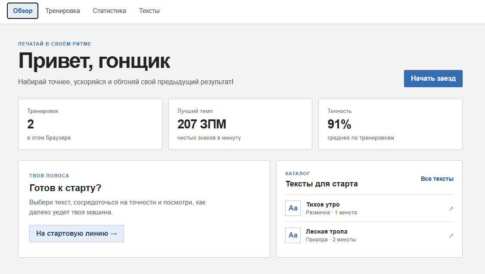
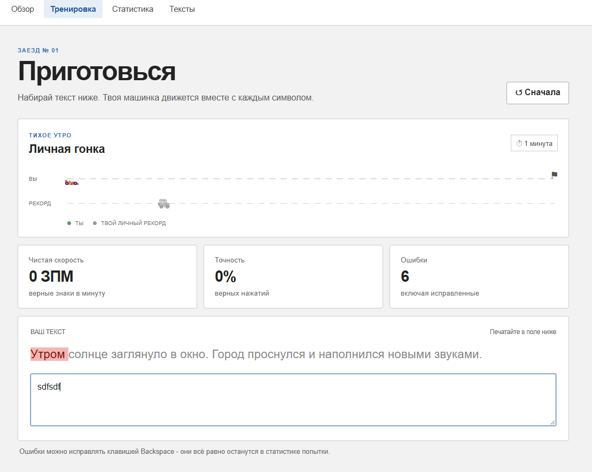
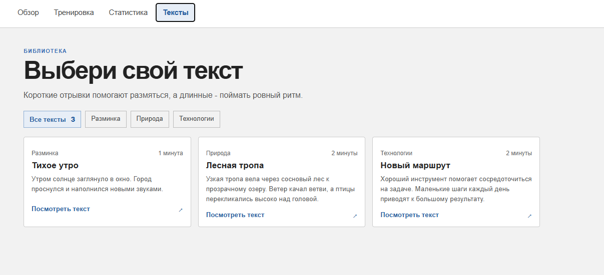
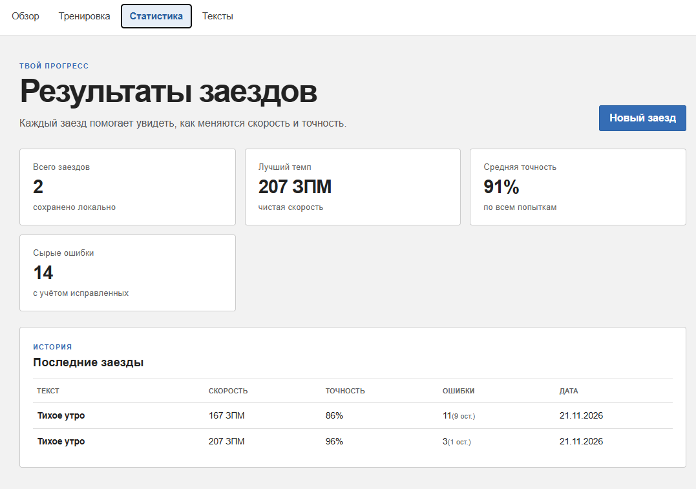

# Тренажёр печати

Небольшое веб-приложение для практики быстрой и точной печати. Пользователь выбирает один из демонстрационных текстов, проходит тренировку и смотрит скорость, точность и историю попыток. Результаты хранятся в `localStorage` текущего браузера.

Проект состоит из двух npm workspaces:

- `coursework-app` — приложение на React, TypeScript и React Router.
- `ui` — библиотека общих React-компонентов, используемая приложением.

## Требования

- Node.js 20.19+ или 22.12+.
- npm 10+.

## Установка и запуск

Из корня репозитория выполните:

```sh
npm install
npm run dev
```

Vite запустит приложение и напечатает локальный адрес в терминале.

## Команды

```sh
npm run build
npm run lint
npm run lint:fix
npm test
npm run test:coverage
```

## Возможности

- Главная страница со сводкой тренировок.
- Каталог из трёх коротких текстов и отдельная страница текста.
- Тренировка с подсветкой правильных и ошибочных символов.
- Подсчёт скорости, точности и ошибок.
- Сохранение истории попыток и страница статистики.
- Адаптивный интерфейс и страница 404.

## Скриншоты
### Главная страница



### Тренировка



### Каталог текстов



### Статистика


